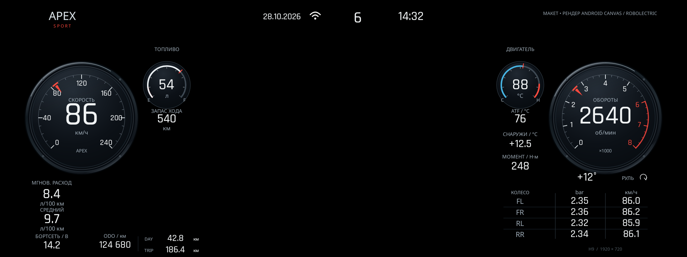
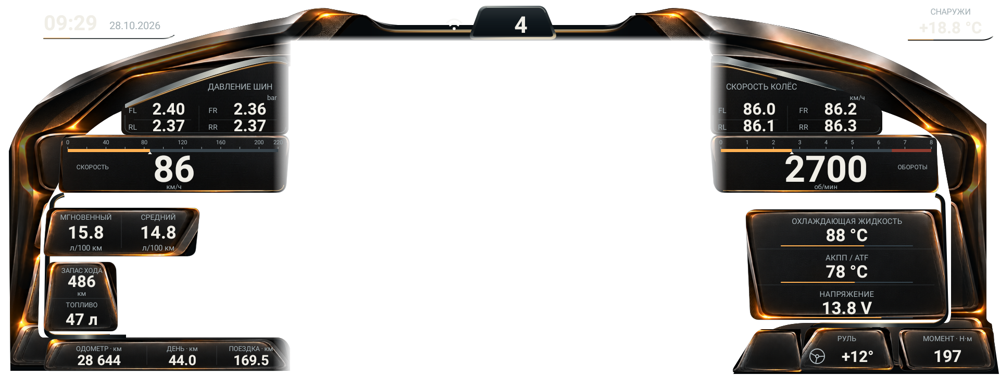
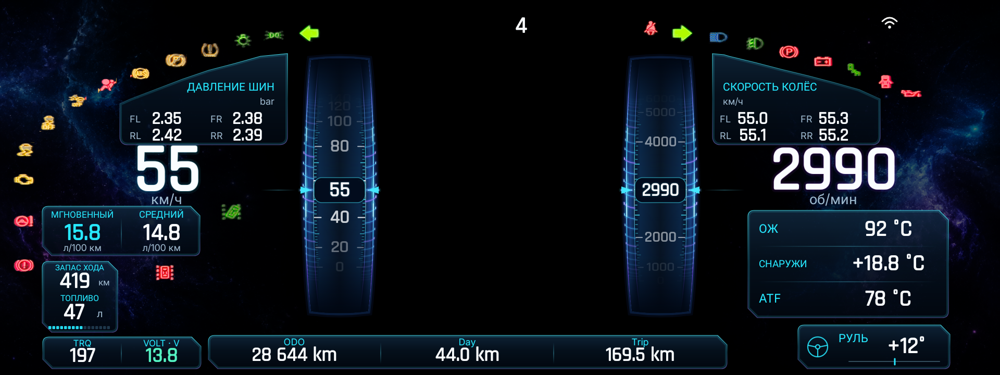
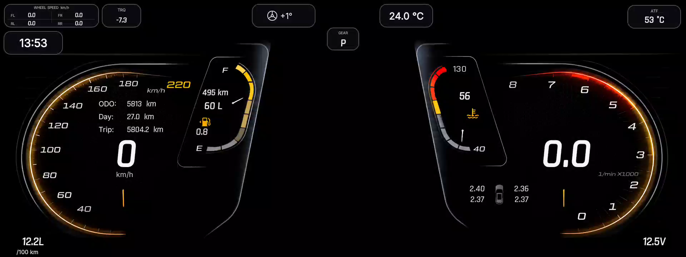
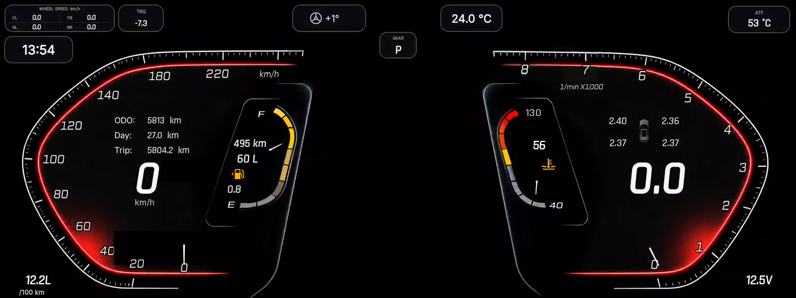
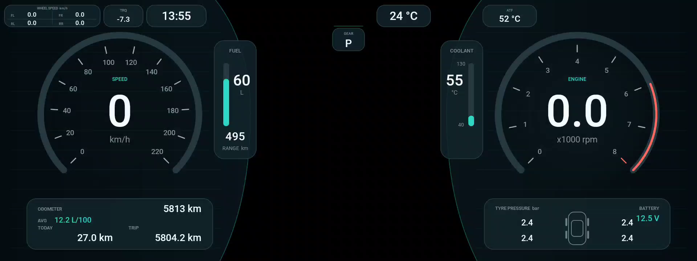
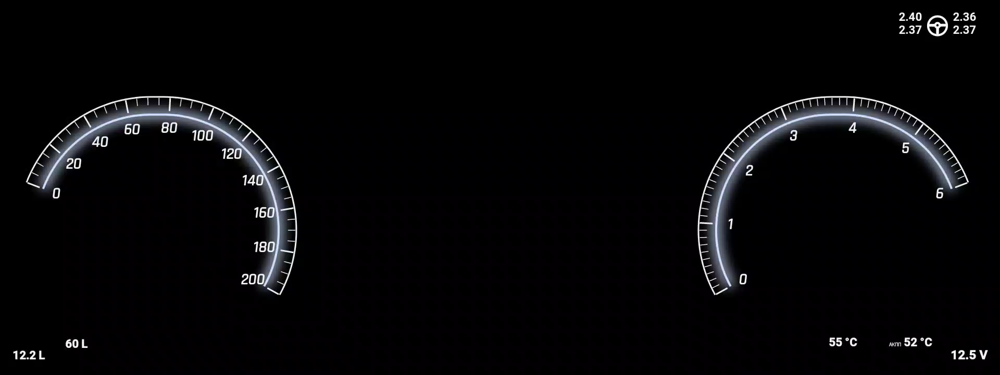

# Скины H9 Cluster

H9 Cluster предоставляет семь независимых скинов для дополнительного экрана
`Display ID 2` размером `1920×720`. Sculpted Titanium показана контрольным
рендером, APEX SPORT — нативным Canvas; снимок ION AURORA получен в эмуляторе из Demo; остальные — через
`scrcpy` с головного устройства Haval на Android 9.

Показания служат для демонстрации компоновки. В контрольном рендере Titanium
и снимке ION AURORA используются примерные данные. Системные индикаторы
на снимке ION AURORA также демонстрационные.

## Общие настройки

В главном окне выберите «Объём бака»: `80 л` (по умолчанию, в том числе после
обновления) или `60 л`. Выбор общий для всех семи скинов. Например, при 50%
топлива темы показывают 40 л для бака 80 л и 30 л для бака 60 л; графические
шкалы в обоих случаях показывают половину бака. Литровые пороги предупреждений
сохранены; Horizon предупреждает при уровне ниже 15%. Запас хода и расход поступают от своих источников
и не масштабируются вместе с баком.

Изменение сразу доступно в предпросмотре. Нажмите «Сохранить и запустить…»,
чтобы применять его при следующих запусках; выход назад без сохранения
возвращает прежние настройки. В Demo выбор также меняет показания топлива.

Во всех темах подключённый Wi-Fi обозначается зелёной иконкой, отключённый —
серой перечёркнутой.

## APEX SPORT

Круглые спортивные приборы в тёмных металлических корпусах расположены у
внешних краёв. Топливо и температура двигателя показаны отдельными дуговыми
указателями; коридор карты шириной 800 px свободен от оформления. Все
27 обязательных показаний сохранены, включая четыре давления и четыре
скорости колёс, Day/Trip, ATF, часы, дату и общий Wi-Fi.

В локальной ревизии 9.7.1 шрифты увеличены на 1 px относительно первого
варианта; номер передачи остаётся в штатном размере. Day/Trip разделены на
две строки с отдельными колонками названия, значения и километров. Верхняя
полоса сохраняет исходную непрозрачность 04: прежнее ослабление alpha могло
открывать фрагменты нижнего слоя возле часов. Граница полосы над картой теперь
соответствует исходной калибровке. В ревизии 9.7.2 восстановлена также исходная
нижняя подложка: её сглаживание открывало штатный пробег между Day и Trip.
Теперь вся подложка 04 используется без изменения пикселей; шрифты и
координаты ревизии 9.7.1 сохранены.

Изображение ниже получено из настоящего `ApexSportClusterView` в нативном
Canvas Robolectric, с демонстрационными значениями. Это не запуск эмулятора
или проверка на автомобиле. Чёрный фон и подпись макета добавлены только
для просмотра; скин сохраняет прозрачность карты. Штатные лампы, буквы
селектора и режим движения присутствуют только в отдельном верхнем слое Demo.

[Исходник, паспорт и проверки](../tools/assets/apex_sport/README_RU.md).

## Sculpted Titanium

Рельефный титановый корпус с янтарной подсветкой и горизонтальными шкалами
по краям. Крупные цифры скорости и оборотов расположены по центру своих
приборов; вспомогательные показания выровнены внутри металлических панелей.
В центре оставлена широкая область для навигации, края оформления плавно
переходят к карте.

Тема показывает все доступные автомобильные показания, часы, дату и Wi-Fi.
Штатный слой выводит буквенный селектор, режим езды и системные индикаторы;
скин дополняет его только номером передачи 1–8 в D. Нижние левые поля
индикаторов остаются свободными. Тахометр движется плавно, а цифры имеют
короткий интервал удержания, чтобы не мерцать на каждом кадре.

Рендер ниже показывает графику приложения без карты и штатных индикаторов;
тёмная центральная область в production прозрачна для навигации.

## ION AURORA

Космическая тема с полупрозрачными боковыми туманностями и двумя вертикальными
барабанными шкалами. Ленты движутся за неподвижными указателями, риски и
цифры уходят в глубину по краям барабана. Скорость и RPM показываются целыми
числами; показания в окнах барабанов совпадают с крупными цифрами.

Средний и мгновенный расход вынесены в отдельную панель, угол руля отделён
от температур. ATF и остальные доступные автомобильные данные сохранены.
Центр остаётся свободным для карты, а панели обходят штатные индикаторы.
Production не рисует имитацию этих индикаторов и название режима езды.

С версии 9.6.1 под штатной передачей расположены часы `HH:mm`, а слева
вверху — дата `dd.MM.yyyy`. Две центральные рамки согласованы по форме и
размеру; Wi-Fi имеет внутренний отступ от рамки. Крупные цифры скорости и
оборотов уменьшены, чтобы не касаться соседних панелей. Галерея ниже снята
до этих изменений.

С версии 9.7.0 крупное показание RPM и цифры в окне барабана используют
общую стабилизацию; движение самой ленты остаётся плавным.

В ION AURORA, Sculpted Titanium, Classic, Sport и Simple приложение дополняет штатную передачу
только цифрой 1–8 в автоматическом режиме D; в M/P/N/R дополнительной
надписи нет. Старые снимки Classic/Sport ниже показывают прежнюю карточку
передачи, удалённую в версии 9.6.0.

## Classic

Классическая компоновка с двумя крупными круговыми шкалами, центральной зоной
для основных показаний и отдельными индикаторами топлива и температуры
охлаждающей жидкости.

С версии 9.6.1 часы находятся под штатной передачей; рамки часов и блока
Wi-Fi/передачи используют такую же серую обводку и скругления, как остальные
карточки Classic. Дата не выводится.

## Sport

Спортивная компоновка с протяжёнными шкалами по периметру, красным акцентом и
крупными цифровыми значениями скорости и оборотов.

С версии 9.6.1 часы находятся под штатной передачей; обе центральные рамки
совпадают по стилю с остальными карточками Sport. Дата не выводится.

## Horizon

Сдержанная тёмная тема с бирюзовыми акцентами, разнесёнными информационными
карточками и двумя симметричными приборами.

## Simple

Минималистичная тема с двумя светлыми шкалами и максимально свободной
центральной областью. Основные вспомогательные показатели расположены по
краям экрана.

## Штатная панель

Вариант `Штатная панель` не является отдельным графическим скином: приложение
ничего не рисует на `Display ID 2`, поэтому на экране остаётся заводская
приборная панель автомобиля.
